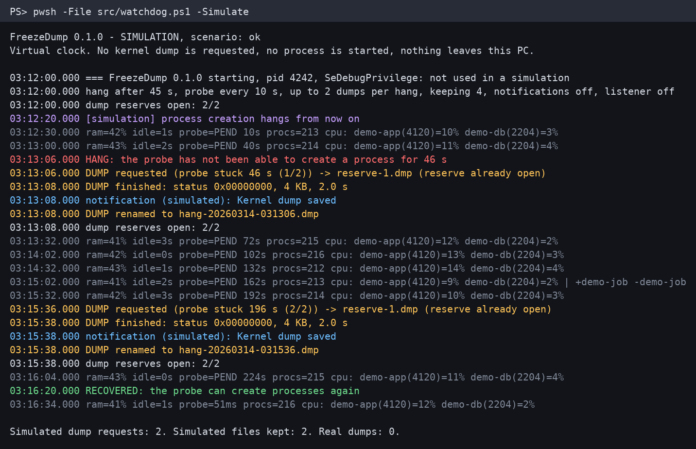

# FreezeDump

[English version](README.md)

<p align="center"></p>

*Salida real de consola de `-Simulate`, con datos inventados. Para hacer esta imagen no se pidió ningún volcado.*

Un vigilante para los cuelgues de Windows que no dejan rastro. Si el sistema deja de poder crear procesos, pide
**por sí solo un volcado del núcleo en vivo**, sin pantallazo azul y sin reiniciar, para que haya algo que
analizar después de tener que apagar con el botón.

> **Experimental. Lee antes las [limitaciones conocidas](#limitaciones-conocidas).** Usa una API de Windows sin
> documentar, solo se ha probado en una versión de Windows y **ninguno de los dos cuelgues reales hasta ahora dejó
> un volcado completo**. El último arreglo aún no se ha probado con un volcado real.

## Qué hace

- Cada 10 s lanza `cmd.exe /c exit 0` y mide cuánto tarda. Lo normal es unos 50 ms.
- Si no ha terminado a los 45 s, apunta `HANG` en el log y pide un volcado del núcleo en vivo: 2 como máximo por
  cuelgue, separados al menos 150 s. El volcado va en su propio hilo y no lanza ningún proceso.
- Deja abiertos los ficheros de volcado desde el arranque, para no tener que crear un fichero durante el cuelgue, y
  los escribe directos a disco, para que el volcado no dependa de la caché de ficheros de Windows.
- Cada 5 s apunta el uso de memoria, el tiempo sin entrada de teclado o ratón, la latencia de la sonda, lo que más
  CPU gasta y qué procesos han empezado o terminado. Cada línea se escribe directa a disco y sobrevive a un reinicio.
- Si quieres, envía un aviso por [ntfy](https://ntfy.sh) y escucha por TCP a un monitor de otra máquina. Las dos
  cosas vienen apagadas. Sin ellas, nada sale del PC.

## Qué no hace

- No evita ni arregla los cuelgues, y no te dice la causa. El volcado lo analizas tú.
- No reinicia el PC ni mata ningún proceso.
- No se entera de un cuelgue en el que solo mueren el teclado o el ratón y los procesos siguen arrancando.
- No puede hacer nada si se para todo el núcleo, porque también se paran sus hilos.
- No funciona antes de iniciar sesión, porque la tarea arranca al iniciarla.
- No considera cuelgue una sonda que falla al instante, por ejemplo si un antivirus bloquea `cmd.exe`. Eso se
  apunta como `probeError`.
- No cambia la configuración de errores de Windows ni sube los volcados a ningún sitio.

## Limitaciones conocidas

### Dos cuelgues reales hasta ahora: aún ningún volcado completo

**Primer cuelgue.** El 31 de octubre de 2026 el PC donde se creó se colgó de verdad. **La detección funcionó:** la sonda dejó de
terminar y el cuelgue se declaró a los 45 s. **El volcado no:** se pidió y nunca terminó. El log siguió
escribiéndose 78 segundos más, hasta que se reinició el PC con el botón. No quedó ningún volcado, ni siquiera un
fichero vacío. Con el PC sano, la misma llamada tarda 2 s o menos.

La explicación más probable es que crear el fichero del volcado se atascó igual que crear un proceso, así que ahora
los ficheros se abren por adelantado. **Esa explicación no está demostrada.** Un fichero recién creado también puede
desaparecer en un reinicio brusco, y puede que lo que se atascara fuera la propia llamada al núcleo. En ese caso,
este arreglo no sirve.

**Segundo cuelgue.** El 2 de noviembre de 2026 se volvió a colgar, con esos ficheros ya abiertos. La detección volvió
a funcionar y esta vez la llamada al núcleo terminó en menos de 13 s, así que esa primera explicación encaja. Después,
cerrar el fichero se atascó: no había terminado 85 s más tarde, cuando se acaba el log, y el PC terminó reiniciándose
con el botón. El fichero rescatado ocupaba 2,7 GB,
pero solo el primer 1,1 GB tenía datos y el resto eran ceros. Los comandos habituales de WinDbg (`!locks`, `!process`,
`!stacks`) no encontraron nada, porque las tablas de páginas y las listas de procesos estaban en la parte perdida. Lo
que se pudo rescatar a mano mostró hilos esperando candados de NTFS, entre ellos dos de los que escriben a disco los
ficheros en caché. Eso encaja con que el volcado se quedara en la caché de ficheros, así que ahora los ficheros de
volcado se escriben directos a disco. **Esa explicación tampoco está demostrada, y la escritura directa no se ha
probado con un volcado real.** Podría hacer que el volcado tarde más, y sigue necesitando que el disco acepte
escrituras. El log se escribe del mismo modo y siguió funcionando durante los dos cuelgues.

| Cuándo | Disparo | Código | Resultado |
|---|---|---|---|
| 31 oct 2026 | A mano, PC sano | Prototipo privado | Bien: 2,5 GB en 2,0 s. WinDbg lo abrió |
| 31 oct 2026 | **Cuelgue real** | Prototipo privado | **Cuelgue detectado a los 45 s. El volcado nunca terminó, sin fichero** |
| 31 oct 2026 | Por TCP, PC sano, con el arreglo | Prototipo privado | Bien: 2273 MB en 1,4 s, cabecera válida, código `0x161` |
| 1 nov 2026 | Pruebas automáticas y simulación | Esta versión, 0.1.0 | Pasan |
| 2 nov 2026 | `-TestDump`, PC sano | Esta versión, 0.1.0 | Bien: 2495 MB en 2,1 s, cabecera válida, código `0x161`. cdb (WinDbg) lo abrió |
| 2 nov 2026 | **Cuelgue real**, ficheros abiertos por adelantado | Prototipo privado | **Cuelgue detectado a los 45 s. La llamada terminó, cerrar el fichero se atascó. Solo 1,1 GB de 2,7 GB llegó a disco** |
| Aún no | `-TestDump` y cuelgue real, con escritura directa a disco | | **Sin probar** |

La versión 0.1.0 es una reescritura limpia de ese prototipo. La llamada nativa es la misma. Este código solo ha
pedido volcados con el PC sano, y los cuelgues reales de arriba fueron con el prototipo. Ejecuta
[`-TestDump`](#instalar) para comprobarlo en tu PC.

### API sin documentar

Llama a `NtSystemDebugControl` con el comando 37 (`SysDbgGetLiveKernelDump`). Microsoft no documenta esta llamada,
así que cualquier actualización de Windows podría cambiarla o quitarla. La estructura sale de notas de ingeniería
inversa de la comunidad (ver [NOTICE](NOTICE)). Lo que Microsoft sí documenta es la función en sí, a través del
[Administrador de tareas](https://learn.microsoft.com/es-es/windows-hardware/drivers/debugger/task-manager-live-dump),
cuyos volcados llevan el mismo código (`0x161`, `LIVE_SYSTEM_DUMP`). No está confirmado que el Administrador de
tareas use esta misma llamada.

### Dónde se ha probado

**Solo** en Windows 11 Pro x64, versión 26H2, compilación 26300.9711, con VBS y HVCI activos, y PowerShell 7.6.
Sin probar en Windows 10, Windows Server, versiones anteriores de Windows 11 ni ARM64.

### Otros límites

- **Requiere permisos de administrador.** La llamada exige `SeDebugPrivilege`, así que la tarea se ejecuta elevada.
  Sin elevar, el log muestra `SeDebugPrivilege: AdjustTokenPrivileges error 1300` y los volcados fallan, y las
  carpetas `logs` y `dumps` no se bloquean, para que el proceso siga teniendo acceso a ellas.
- **Un volcado congela brevemente todo el PC**, unos 2 s en las pruebas de arriba.
- **Un volcado puede salir bien y estar incompleto.** Microsoft avisa de que la captura necesita temporalmente
  memoria física libre suficiente para guardar una copia de lo que escribe.
- **No se comprueba el espacio libre en disco.** Con el disco lleno, el volcado puede fallar.

## Si falla un volcado

| Qué ocurre | Qué obtienes |
|---|---|
| La llamada devuelve un error | `DUMP finished: status 0x...` en el log y un aviso `Kernel dump FAILED`. Se borra el fichero vacío. Lo reintenta una vez 150 s después y sigue funcionando |
| La llamada no vuelve nunca (puede que fuera lo que pasó en el cuelgue real) | A los 30 s, `DUMP STUCK` en el log con el paso en el que está, y un aviso. No intenta otro volcado hasta reiniciarse. Tendrás que reiniciar el PC |
| El PC se reinicia durante un volcado | En el siguiente arranque, un fichero de reserva con datos se guarda como `hang-*-rescued.dmp`. **Puede estar cortado e inservible** |
| No se pudieron abrir los ficheros de reserva | Se apunta en el log, y el volcado crea su fichero en ese momento, que es lo que quizá falló antes |
| Se muere el proceso del vigilante | La tarea lo reinicia cada minuto, hasta 999 veces |
| La configuración tiene un error | No arranca. El motivo está en `startup-error.log`, en `%ProgramData%\FreezeDump` |
| No se puede bloquear la carpeta `logs` o `dumps` | No arranca, porque otros usuarios podrían leer los volcados. El motivo también está en `startup-error.log` |

Durante un cuelgue también puede fallar el aviso. Lo primero que hay que mirar es el log.

## Dónde van los volcados y cuánto ocupan

- **Dónde:** `%ProgramData%\FreezeDump\dumps\hang-AAAAMMDD-HHMMSS.dmp`. Los logs están en `logs\`.
- **Cuánto:** de 2,3 a 2,5 GB cada uno en el PC de pruebas. Es solo memoria del núcleo, sin comprimir, así que crece
  con la memoria del núcleo en uso. Los 4 que se guardan por defecto serían unos 10 GB a ese tamaño. Los más viejos
  se borran.
- **Ficheros de reserva:** `reserve-1.dmp` y `reserve-2.dmp` ocupan 0 bytes hasta que se usan.
- **Logs:** unos 2 MB al día, se guardan 30 días.
- **Privacidad:** los volcados contienen memoria del núcleo, que puede incluir contraseñas, claves y datos de red.
  Las carpetas `logs` y `dumps` solo las pueden leer los administradores, también con tu propio `dataDir`: el
  vigilante las bloquea cada vez que arranca. No publiques un volcado.

## Requisitos

- Windows x64 y [PowerShell 7.4 o posterior](https://github.com/PowerShell/PowerShell) (solo se ha probado la 7.6).
  Windows PowerShell 5.1 se rechaza con un error claro.
- Permisos de administrador para instalarlo y ejecutarlo. La simulación y las pruebas no los necesitan.

## Obtener el código

```powershell
git clone https://github.com/javimentallab/FreezeDump
cd FreezeDump
```

Si en lugar de eso descargas el ZIP, Windows marca sus ficheros como venidos de internet y PowerShell se niega a
ejecutarlos. Desbloquéalos una vez, desde la carpeta descomprimida:

```powershell
Get-ChildItem -Recurse -File | Unblock-File
```

## Pruébalo sin riesgo

La simulación ejecuta el código real de detección, reservas y rotación sobre un reloj virtual. No pide ningún
volcado, no lanza ningún proceso, nada sale del PC y no necesita permisos de administrador ni instalación.

```powershell
pwsh -File src/watchdog.ps1 -Simulate
pwsh -File src/watchdog.ps1 -Simulate -Scenario dump-fails
pwsh -File src/watchdog.ps1 -Simulate -Scenario dump-stuck   # lo que quizá pasa en un cuelgue real
```

## Instalar

Desde una consola de PowerShell 7 elevada, en esta carpeta:

```powershell
Copy-Item config.example.json config.json   # opcional: edítalo antes, git lo ignora
.\install.ps1 -WhatIf                       # enseña cada paso y no cambia nada
.\install.ps1
```

Esto copia el programa a `%ProgramFiles%\FreezeDump`, crea `%ProgramData%\FreezeDump` con lectura solo
para administradores y registra la tarea `FreezeDump`. La tarea se ejecuta elevada al iniciar sesión, sin
aviso de UAC y sin ventana. Si elevas con otra cuenta, indica la tuya con `-User`. Solo se añade una regla de
cortafuegos si la escucha se activa para otras máquinas.

Después, comprueba que tu PC admite la llamada. Esto pide **un volcado real**: pregunta antes, congela el PC unos
2 s y escribe varios GB.

```powershell
pwsh -File "$env:ProgramFiles\FreezeDump\src\watchdog.ps1" -TestDump
```

Un resultado correcto es `status 0x00000000`. Borra luego el fichero `test-*.dmp`.

## Desinstalar

Desde una consola de PowerShell 7 elevada, en esta carpeta o en la instalada:

```powershell
.\uninstall.ps1 -WhatIf       # enseña cada paso y no cambia nada
.\uninstall.ps1               # conserva logs, volcados y configuración
.\uninstall.ps1 -RemoveData   # los borra también
```

En una carpeta indicada con `dataDir`, `-RemoveData` solo borra los logs y volcados que escribió el vigilante, y
las carpetas que eso deje vacías. Todo lo demás que haya se queda.

## Configuración

Se instala en `%ProgramData%\FreezeDump\config.json`, a partir de [`config.example.json`](config.example.json).
Los ajustes desconocidos y los valores fuera de rango dan error. Comprueba un fichero con
`watchdog.ps1 -CheckConfig -ConfigPath <fichero>`. Tras un cambio hay que reiniciar el vigilante: cierra e inicia
sesión, o vuelve a ejecutar `install.ps1`. Al volver a ejecutarlo se conserva la configuración instalada. Para
sustituirla por el `config.json` de esta carpeta, usa `.\install.ps1 -ReplaceConfig`.

| Ajuste | Por defecto | Significado |
|---|---|---|
| `dataDir` | Junto al fichero de configuración | Carpeta de logs y volcados, en una unidad local |
| `hangSeconds` | 45 | Cuánto puede tardar la sonda antes de contar como cuelgue |
| `probeIntervalSeconds` | 10 | Cada cuánto se lanza la sonda |
| `sampleIntervalSeconds` | 5 | Cada cuánto se apunta una línea |
| `maxDumpsPerHang` | 2 | Volcados por cuelgue. Con 0 solo se apunta el cuelgue |
| `minSecondsBetweenDumps` | 150 | Separación mínima entre volcados |
| `keepDumps` | 4 | Cuántos `hang-*.dmp` se guardan |
| `reserveFiles` | 2 | Ficheros de volcado abiertos por adelantado |
| `logRetentionDays` | 30 | Cuánto se guardan los logs |
| `ntfy.url`, `ntfy.token` | Vacíos | Avisos opcionales. `https`, o `http` solo para una dirección local o de la LAN |
| `listener.*` | Apagado | Escucha TCP opcional, ver abajo |

Envía un aviso de prueba con `watchdog.ps1 -TestNotify`.

### Opcional: vigilar desde otra máquina

Si un cuelgue también bloquea las conexiones remotas, otra máquina puede notarlo y pedir ella el volcado:

```json
"listener": {
  "enabled": true,
  "bindAddress": "0.0.0.0",
  "port": 47999,
  "allowedClients": ["192.0.2.10"],
  "token": "una-cadena-larga-y-aleatoria-de-16-caracteres-o-mas"
}
```

```sh
printf 'ping' | nc <pc> 47999                 # una línea con el estado actual
printf '<token> dump' | nc <pc> 47999         # pide un volcado
```

Solo pueden conectarse el propio PC y `allowedClients`, y sin token no se puede pedir `dump`. **El token viaja sin
cifrar, así que úsalo solo en una red de confianza.**

## Analizar un volcado

Ábrelo con [WinDbg](https://learn.microsoft.com/es-es/windows-hardware/drivers/debugger/) y prueba `!locks` (quién
tiene cada bloqueo), `!stacks 2` (a qué esperan los hilos) y `!process 0 7`.

## Idioma de la interfaz

No tiene interfaz gráfica. Los mensajes de consola, las líneas del log y los avisos están solo en inglés.

## Pruebas

```powershell
pwsh -File tests/run-tests.ps1
```

Cubren la detección, la configuración, la simulación y la escucha, sin dependencias. Nunca piden un volcado: la
llamada nativa está detrás de una barrera que solo abren los puntos de entrada reales, y las pruebas no los llaman.
Ejecutan `install.ps1` y `uninstall.ps1` solo con `-WhatIf` y carpetas temporales, y no ejercitan el volcado real ni
un aviso real.

La CI también ejecuta CodeQL sobre el C#, Trivy y, sobre los scripts,
[PSScriptAnalyzer](https://github.com/PowerShell/PSScriptAnalyzer). Para ejecutar este último aquí, usa
`tests/run-analyzer.ps1`, que necesita el módulo.

## Contribuir

Consulta [CONTRIBUTING](CONTRIBUTING.md), en inglés. Para avisar en privado de un problema de seguridad, consulta [SECURITY](SECURITY.md).

## Licencia

[MIT](LICENSE). Ver [NOTICE](NOTICE) para terceros.
