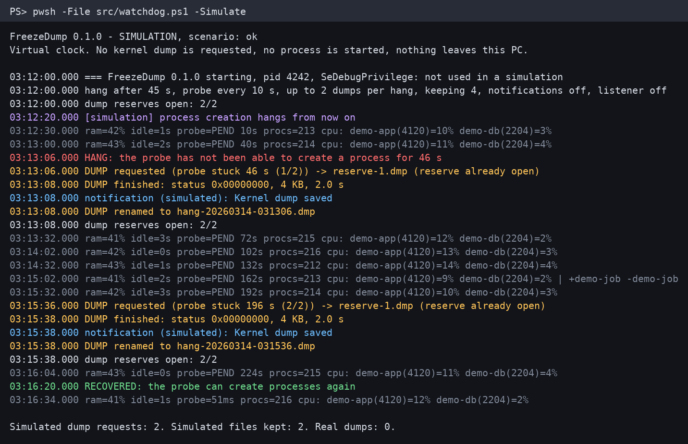

# FreezeDump

[Versión en español](README.es.md)

<p align="center"></p>

*Real console output of `-Simulate`, with made-up data. No dump was requested to make this picture.*

A watchdog for Windows freezes that leave nothing behind. If the system stops being able to create
processes, it asks for a **live kernel memory dump on its own**, with no blue screen and no reboot, so there
is something to analyze after you have had to press the power button.

> **Experimental. Read [Known limitations](#known-limitations) first.** It relies on an undocumented Windows
> API, it has been tested on one Windows version only, and **neither of the two real hangs so far left a
> complete dump**. The latest fix has only been tried on a healthy PC, never during a real hang.

## What it does

- Every 10 s it starts `cmd.exe /c exit 0` and times it. Normally that takes about 50 ms.
- If it has not ended after 45 s, it logs `HANG` and requests a live kernel dump: at most 2 per hang, at
  least 150 s apart. The dump runs on its own thread and starts no process.
- It keeps the dump files open from startup, so a dump does not need to create a file during the hang, and
  writes them through to disk, so a dump does not depend on the Windows file cache.
- Every 5 s it logs memory use, input idle time, probe latency, top CPU and which processes started or
  ended. Each line is written through to disk, so the log survives a reset.
- Optionally, it sends an [ntfy](https://ntfy.sh) notification and listens on TCP for a monitor on another
  machine. Both are off by default. Without them, nothing leaves the PC.

## What it does not do

- It does not prevent or fix hangs, and it does not tell you the cause. You analyze the dump yourself.
- It does not restart the PC or kill any process.
- It does not notice a hang where only the keyboard or mouse die while processes still start normally.
- It can not do anything if the whole kernel stops, because its own threads stop too.
- It does not run before you log on, as the task starts at logon.
- It does not treat a probe that fails at once as a hang, for example when security software blocks
  `cmd.exe`. That is logged as `probeError`.
- It does not change the Windows crash settings and it does not upload dumps anywhere.

## Known limitations

### Two real hangs so far: no complete dump yet

**First hang.** On 31 October 2026 the PC it was built on hung for real. **Detection worked:** the probe stopped ending and
the hang was declared at 45 s. **The dump did not:** it was requested and never finished. The log kept being
written for 78 more seconds, until the PC was reset with the power button. No dump was left, not even an
empty file. On a healthy PC the same call takes 2 s or less.

The likeliest explanation is that creating the dump file blocked just as creating a process did, so the files
are now opened in advance. **That explanation is not proven.** A newly created file can also vanish in a hard
reset, and the kernel call itself may be what blocked. In that case this fix does not help.

**Second hang.** On 2 November 2026 it hung again, with those files already open. Detection worked again and
this time the kernel call returned within 13 s, so that first explanation fits. Then closing the file blocked:
it had not finished 85 s later, when the log stops, and the PC ended up being reset with the power button. The
rescued file was 2.7 GB, but only the first 1.1 GB held data and
the rest was zeros. WinDbg's usual commands (`!locks`, `!process`, `!stacks`) found nothing, because the page
tables and process lists were in the missing part. What could be recovered by hand showed threads waiting on
NTFS locks, among them two of the threads that write cached files to disk. That fits the dump having stayed in
the file cache, so the dump files are now written through to disk. **That explanation is not proven either, and
write-through has only been tried on a healthy PC.** It still needs the disk to accept writes. The log is written the same way and kept going during both hangs.

| When | Trigger | Code | Result |
|---|---|---|---|
| 31 Oct 2026 | By hand, healthy PC | Private prototype | OK: 2.5 GB in 2.0 s. WinDbg opened it |
| 31 Oct 2026 | **Real hang** | Private prototype | **Hang detected at 45 s. The dump never finished, no file** |
| 31 Oct 2026 | Over TCP, healthy PC, with the fix | Private prototype | OK: 2273 MB in 1.4 s, valid header, code `0x161` |
| 1 Nov 2026 | Automated tests and simulation | This version, 0.1.0 | Pass |
| 2 Nov 2026 | `-TestDump`, healthy PC | This version, 0.1.0 | OK: 2495 MB in 2.1 s, valid header, code `0x161`. cdb (WinDbg) opened it |
| 2 Nov 2026 | **Real hang**, files opened in advance | Private prototype | **Hang detected at 45 s. The call returned, closing the file blocked. Only 1.1 GB of 2.7 GB reached the disk** |
| 2 Nov 2026 | Over TCP, healthy PC, written through to disk | Private prototype | OK: 2820 MB in 3.4 s, valid header, code `0x161`. cdb (WinDbg) listed 327 processes, with no truncation warning |
| Not yet | `-TestDump` and real hang, written through to disk | | **Never tested** |

Version 0.1.0 is a cleaned-up rewrite of that prototype. The native call is the same. This code has only
requested a dump on a healthy PC, and the real hangs above happened with the prototype. Run
[`-TestDump`](#install) to check it on your own PC.

### Undocumented API

It calls `NtSystemDebugControl` with command 37 (`SysDbgGetLiveKernelDump`). Microsoft does not document this
call, so any Windows update could change or remove it. The structure layout comes from community
reverse-engineering notes (see [NOTICE](NOTICE)). What Microsoft does document is the feature itself, through
[Task Manager](https://learn.microsoft.com/en-us/windows-hardware/drivers/debugger/task-manager-live-dump),
whose dumps carry the same code (`0x161`, `LIVE_SYSTEM_DUMP`). Whether Task Manager uses this same call has
not been confirmed.

### Tested on

**Only** Windows 11 Pro x64, version 26H2, build 26300.9711, with VBS and HVCI on, and PowerShell 7.6.
Not tested on Windows 10, Windows Server, earlier Windows 11 versions or ARM64.

### Other limits

- **It needs administrator rights.** The call requires `SeDebugPrivilege`, so the task runs elevated. Without
  elevation the log shows `SeDebugPrivilege: AdjustTokenPrivileges error 1300` and dumps fail, and the `logs`
  and `dumps` folders are not locked, so that the process keeps access to them.
- **A dump briefly freezes the whole PC**, about 2 s in the tests above.
- **A dump can succeed and still be incomplete.** Microsoft says the capture temporarily needs enough free
  physical memory to hold a copy of what it writes.
- **Free disk space is not checked.** A dump can fail on a full disk.

## If a dump fails

| What happens | What you get |
|---|---|
| The call returns an error | `DUMP finished: status 0x...` in the log and a `Kernel dump FAILED` notification. An empty file is removed. It tries once more 150 s later and keeps running |
| The call never returns (the real hang may have been this) | After 30 s, `DUMP STUCK` in the log naming the step, and a notification. No further dump is attempted until it restarts. You will have to reset the PC |
| The PC is reset during a dump | At the next start, a reserve file that holds data is kept as `hang-*-rescued.dmp`. **It may be truncated and unusable** |
| The reserve files could not be opened | It is logged, and the dump creates its file at that moment, which is what may have failed before |
| The watchdog process dies | The task restarts it every minute, up to 999 times |
| The config has an error | It does not start. The reason is in `startup-error.log` in `%ProgramData%\FreezeDump` |
| The `logs` or `dumps` folder can not be locked | It does not start, because other users could read the dumps. The reason is in `startup-error.log` too |

A notification can also fail during a hang. The log is what to check first.

## Where the dumps go and how big they are

- **Where:** `%ProgramData%\FreezeDump\dumps\hang-YYYYMMDD-HHMMSS.dmp`. Logs are in `logs\`.
- **How big:** 2.3 to 2.5 GB each on the test PC. It is kernel memory only, uncompressed, so it grows with
  the kernel memory in use. The 4 kept by default would take about 10 GB at that size. Older ones are deleted.
- **Reserve files:** `reserve-1.dmp` and `reserve-2.dmp` take 0 bytes until used.
- **Logs:** about 2 MB per day, kept for 30 days.
- **Privacy:** dumps hold kernel memory, which can include passwords, keys and network data. The `logs` and
  `dumps` folders are readable by administrators only, also with your own `dataDir`: the watchdog locks them
  every time it starts. Do not post a dump publicly.

## Requirements

- Windows x64 and [PowerShell 7.4 or later](https://github.com/PowerShell/PowerShell) (only 7.6 has been
  tested). Windows PowerShell 5.1 is refused with a clear error.
- Administrator rights to install and to run. No admin rights are needed for the simulation or the tests.

## Get the code

```powershell
git clone https://github.com/javimentallab/FreezeDump
cd FreezeDump
```

If you download the ZIP instead, Windows marks its files as coming from the internet and PowerShell refuses to
run them. Unblock them once, from the unzipped folder:

```powershell
Get-ChildItem -Recurse -File | Unblock-File
```

## Try it safely

The simulation runs the real detection, reserve and rotation code on a virtual clock. No dump is requested,
no process is started, nothing leaves the PC, and it needs no admin rights or installation.

```powershell
pwsh -File src/watchdog.ps1 -Simulate
pwsh -File src/watchdog.ps1 -Simulate -Scenario dump-fails
pwsh -File src/watchdog.ps1 -Simulate -Scenario dump-stuck   # what a real hang may look like
```

## Install

From an elevated PowerShell 7 prompt, in this folder:

```powershell
Copy-Item config.example.json config.json   # optional: edit it first, it is ignored by git
.\install.ps1 -WhatIf                       # shows every step and changes nothing
.\install.ps1
```

This copies the program to `%ProgramFiles%\FreezeDump`, creates `%ProgramData%\FreezeDump`
readable by administrators only, and registers the task `FreezeDump`. The task runs elevated when you
log on, with no UAC prompt and no window. If you elevate with a different account, name yours with `-User`. A
firewall rule is only added if the listener is enabled for other machines.

Then check that your PC supports the call. This requests **one real dump**: it asks first, freezes the PC for
about 2 s and writes several GB.

```powershell
pwsh -File "$env:ProgramFiles\FreezeDump\src\watchdog.ps1" -TestDump
```

A healthy result is `status 0x00000000`. Delete the `test-*.dmp` file afterwards.

## Uninstall

From an elevated PowerShell 7 prompt, in this folder or in the installed one:

```powershell
.\uninstall.ps1 -WhatIf       # shows every step and changes nothing
.\uninstall.ps1               # keeps logs, dumps and config
.\uninstall.ps1 -RemoveData   # deletes them too
```

In a folder set with `dataDir`, `-RemoveData` only deletes the logs and dumps that the watchdog wrote, and the
folders that this leaves empty. Anything else in there stays.

## Configuration

Installed at `%ProgramData%\FreezeDump\config.json`, based on [`config.example.json`](config.example.json).
Unknown settings and out-of-range values are errors. Check a file with `watchdog.ps1 -CheckConfig -ConfigPath <file>`.
Restart the watchdog after a change: log off and on again, or run `install.ps1` again. Running it again keeps the
installed config. To replace that with the `config.json` in this folder, use `.\install.ps1 -ReplaceConfig`.

| Setting | Default | Meaning |
|---|---|---|
| `dataDir` | Next to the config file | Folder for logs and dumps, on a local drive |
| `hangSeconds` | 45 | How long the probe can take before it counts as a hang |
| `probeIntervalSeconds` | 10 | How often the probe runs |
| `sampleIntervalSeconds` | 5 | How often a line is logged |
| `maxDumpsPerHang` | 2 | Dumps per hang. 0 only logs the hang |
| `minSecondsBetweenDumps` | 150 | Minimum gap between dumps |
| `keepDumps` | 4 | How many `hang-*.dmp` to keep |
| `reserveFiles` | 2 | Dump files opened in advance |
| `logRetentionDays` | 30 | How long logs are kept |
| `ntfy.url`, `ntfy.token` | Empty | Optional notifications. `https`, or plain `http` only for a loopback or LAN address |
| `listener.*` | Off | Optional TCP listener, see below |

Send a test notification with `watchdog.ps1 -TestNotify`.

### Optional: monitor from another machine

If a hang also blocks remote logins, another machine can notice that and ask for the dump itself:

```json
"listener": {
  "enabled": true,
  "bindAddress": "0.0.0.0",
  "port": 47999,
  "allowedClients": ["192.0.2.10"],
  "token": "a-long-random-string-of-at-least-16-characters"
}
```

```sh
printf 'ping' | nc <pc> 47999                 # one line with the current state
printf '<token> dump' | nc <pc> 47999         # asks for a dump
```

Only loopback and `allowedClients` can connect, and `dump` is unavailable without a token. **The token travels
unencrypted, so use this only on a network you trust.**

## Analyzing a dump

Open it with [WinDbg](https://learn.microsoft.com/en-us/windows-hardware/drivers/debugger/) and try
`!locks` (who holds which lock), `!stacks 2` (what threads are waiting for) and `!process 0 7`.

## Interface language

There is no graphical interface. Console messages, log lines and notifications are in English only.

## Tests

```powershell
pwsh -File tests/run-tests.ps1
```

They cover detection, configuration, the simulation and the listener, with no dependencies. They never request
a dump: the native call is behind a gate that only the real entry points open, and the tests do not call those.
They run `install.ps1` and `uninstall.ps1` only with `-WhatIf` and temporary folders, and they do not exercise the
real dump or a real notification.

CI also runs CodeQL on the C#, Trivy, and [PSScriptAnalyzer](https://github.com/PowerShell/PSScriptAnalyzer) on the
scripts. To run that last one here, use `tests/run-analyzer.ps1`, which needs the module.

## Contributing

See [CONTRIBUTING](CONTRIBUTING.md). To report a security problem privately, see [SECURITY](SECURITY.md).

## License

[MIT](LICENSE). See [NOTICE](NOTICE) for third parties.
